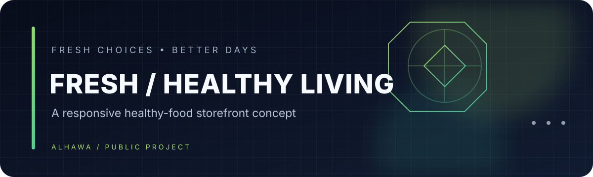

# Checking-networks · Healthy Food Website

A responsive front-end website concept for a healthy-food storefront, built with HTML and CSS.

## Experience
- Home, product, about, services, reviews, and contact sections.
- Product and editorial imagery.
- Responsive navigation and layout styling.
- A single-page structure with anchor navigation.

## Run locally
1. Clone or download this repository.
2. Open `index.html` in a modern browser.
3. Preserve the existing `images/` directory and image assets; the page references them by relative path.
4. Keep `style.css` and `script.js` beside the HTML file (if present).

## Technology
- HTML5
- CSS3
- Font Awesome and jQuery are loaded from public CDNs.

> This repository is a front-end demonstration. The contact form and product actions need a backend or service integration before they can process real orders or messages.

---

<b>FRESH IDEAS</b> · A healthier web experience.

